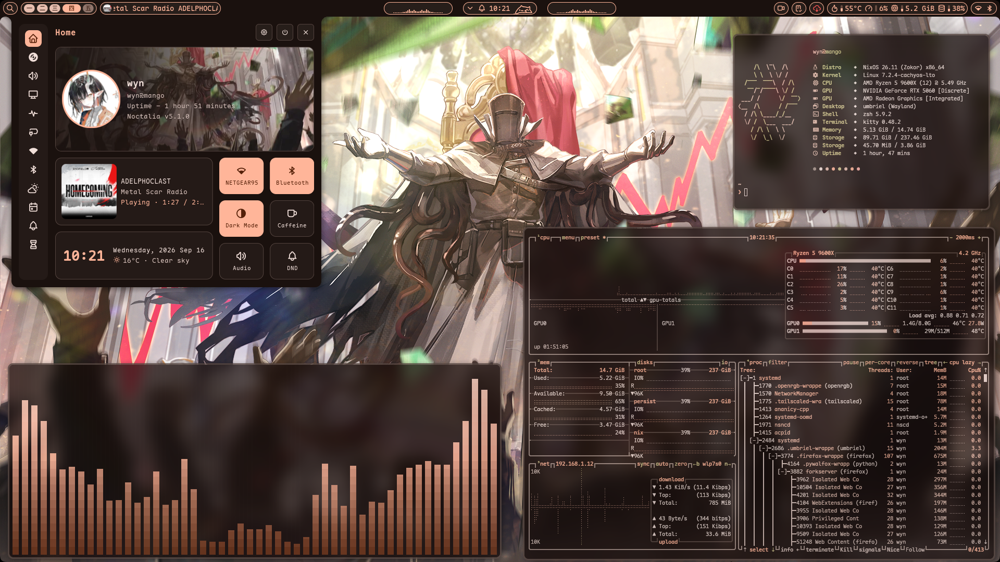

<h2 align="center">My half-baked dendritic flake</h2>

<p align="center">
  <a href="./docs/INSTALLATION.md"><strong>Installation</strong></a> ❄️
  <a href="./docs/DEPLOYMENT.md"><strong>Deployment</strong></a> ❄️
  <a href="./docs/TROUBLESHOOT.md"><strong>Troubleshoot</strong></a>
</p>



## Layout

```hs
./
├── .tack/                 # flake inputs
├── flake.nix              # flake outputs
├── lib/                   # helper libraries
├── deploy.nix             # remote deployment via deploy-rs
├── ci.nix                 # cache push CI
├── scripts/               # custom shell scripts
└── modules/
    ├── _overlays/         # overlays for nixpkgs
    ├── _wrappers/         # adios wrappers
    ├── hosts/             # host-specific configurations
    ├── common/            # common features across classes
    ├── nixos/             # nixos-specific features
    └── darwin/            # darwin-specific features
```

<details>
<summary>More details on the config structure</summary>

**Lamina:** A helper library developed by
[iynaix](https://github.com/iynaix/lamina) for multi-host setups, which I forked
and heavily adapted for my use case (see [lamina.nix](./lib/lamina.nix)).

- **File import:** Every `.nix` file under `modules/` is imported recursively.
  Files and directories prefixed with an underscore `_` are skipped.

- **File structure:** Each file is either an unfiltered attrset (or a function
  returning one) loaded on every host, or an _envelope_: an attrset with a
  `module` key holding the actual contents, plus filter keys that decide which
  hosts can load it:
  ```nix
  {
    hjemCompat = false;
    targets = ["mango"];
    tags = ["desktop"];
    platforms = ["linux"];
    module = { pkgs, ... }: { /* ... */ };
  }
  ```

- **Filtering:** Envelope filters are ANDed together:
  - `tags`: the host must have _all_ of the listed tags.
  - `platforms`: the host must match _any_ of the listed platforms (e.g.
    `linux`, `aarch64-linux`).
  - `targets`: the bare host name, or `user@host` on hjem hosts (a bare host
    matches every user on it).
  - `hjemCompat`: marks the file as safe to load on hjem hosts. Defaults to
    `false`, files must be opt-in.

  Singular aliases (`tag`, `platform`, `target`) are accepted, and unknown keys
  throw an error naming the offending file.

- **Hjem hosts:** For non-NixOS distros, [hjem-shim.nix](./lib/hjem-shim.nix)
  evaluates only the `hj.*` options (`hj.files`, `hj.xdg.*`, `hj.packages`) from
  the shared files and ignores everything else. Anything using
  `imports = [ ... ];` causes an infinite recursion error under the shim, so
  files are skipped on hjem hosts by default. Only files marked with
  `hjemCompat = true;` get loaded, and those must not include `imports`.

- **Presets:** A host is declared in `flake.nix` with a preset that picks the
  builder, default system and whether to apply nixpkgs overlays:

  | Preset   | Builder                              | Default System |
  | -------- | ------------------------------------ | -------------- |
  | `nixos`  | `nixpkgs.lib.nixosSystem`            | x86_64-linux   |
  | `rpi`    | `nixos-raspberrypi.lib.nixosSystem`  | aarch64-linux  |
  | `darwin` | `nix-darwin.lib.darwinSystem`        | aarch64-darwin |
  | `hjem`   | [hjem-shim.nix](./lib/hjem-shim.nix) | x86_64-linux   |

**Wrappers:** I opt for using wrappers, specifically
[adios-wrappers](https://github.com/llakala/adios-wrappers), instead of
[home-manager](https://github.com/nix-community/home-manager) or
[hjem-rum](https://github.com/snugnug/hjem-rum) to configure most programs. A
wrapper bundles the program with its own configuration so that I can easily
`nix run` my own version of that program anywhere. Using wrappers also provides
some additional improvements in evaluation time. Thanks
[pengo](https://forge.pengo.uk/pengo/) and [iynaix](https://github.com/iynaix)
for enlightening me on the power of wrappers! 🥹

</details>

## Hosts

| Host                                  | Platform         | OS          | Preset   | DE                                                                                                        |
| ------------------------------------- | ---------------- | ----------- | -------- | --------------------------------------------------------------------------------------------------------- |
| [apricot](./modules/hosts/apricot/)   | `aarch64-darwin` | MacOS       | `darwin` | [OmniWM](https://github.com/BarutSRB/OmniWM)                                                              |
| [capybara](./modules/hosts/capybara/) | `x86_64-linux`   | CachyOS     | `hjem`   | [Umbriel](https://github.com/noctalia-dev/umbriel) + [Noctalia](https://github.com/noctalia-dev/noctalia) |
| [lettuce](./modules/hosts/lettuce/)   | `x86_64-linux`   | WSL (NixOS) | `nixos`  |                                                                                                           |
| [mango](./modules/hosts/mango/)       | `x86_64-linux`   | NixOS       | `nixos`  | [Umbriel](https://github.com/noctalia-dev/umbriel) + [Noctalia](https://github.com/noctalia-dev/noctalia) |
| [puffin](./modules/hosts/puffin/)     | `aarch64-linux`  | NixOS       | `rpi`    |                                                                                                           |

## Acknowledgement

Huge thanks to everyone whose configurations I have ~~stolen~~ referenced and
incorporated into my setup, especially the folks in **Noctalia** and **Vimjoyer
community** on Dicord.

### References

- **[linusammon/nixos-config](https://github.com/linusammon/nixos-config):**
  Migrate away from [flake-parts](https://github.com/hercules-ci/flake-parts)
  and [import-tree](https://github.com/denful/import-tree)
- **[iynaix/dotfiles](https://github.com/iynaix/dotfiles):** Helpful tools
  ([lamina](https://github.com/iynaix/lamina),
  [tack](https://github.com/manic-systems/tack),
  [nvfetcher](https://github.com/berberman/nvfetcher),
  [nixpkgs-multiverse](https://github.com/fzakaria/nixpkgs-multiverse))
- **[pengo/nixos](https://forge.pengo.uk/pengo/nixos):** Introduction to
  [adios-wrappers](https://github.com/llakala/adios-wrappers)
- **[iStellanova/Stellyrland](https://github.com/iStellanova/Stellyrland):** Set
  up [nix-homebrew](https://github.com/zhaofengli/nix-homebrew) and
  [OmniWM](https://github.com/BarutSRB/OmniWM)
- **[rysieko.pl/nixossmth](https://tangled.org/rysieko.pl/nixossmth):** Set up
  [preservation](https://github.com/nix-community/preservation)
- **[eljangus/nixos](https://github.com/eljangus/nixos):** Pretty cursor and
  fastfetch themes
- **[samiser/nix-configs](https://github.com/samiser/nix-configs):** Self-host
  cache with [attic](https://github.com/zhaofengli/attic) and cache push CI
- **[LucasOe/nixos-config](https://github.com/LucasOe/nixos-config):** Home
  Manager globbing mimeapps
- **[Baitinq/nixos-config](https://github.com/Baitinq/nixos-config):** Remote
  deployment with [deploy-rs](https://github.com/serokell/deploy-rs)
- **[Zaney/zaneyos](https://gitlab.com/Zaney/zaneyos):** My starting point
  (non-dendritic flake)
- **[Doc-Steve/dendritic-design-with-flake-parts](https://github.com/Doc-Steve/dendritic-design-with-flake-parts):**
  Guide to setup dendritic pattern
